# Architecture

## Request flow

```mermaid
flowchart LR
  C[HTTP client] --> A[Bounded connection listener]
  A --> G[Global admission slot]
  G --> Q[Bounded request body]
  Q --> S[Select and reserve backend]
  S --> T[Pooled HTTP transport]
  T --> B[Read bounded complete response]
  B --> R[Observe outcome and release backend]
  R --> D[Deliver response]
  D --> F[Release global slot]
```

The proxy uses `net/http/httputil.ReverseProxy` for forwarding semantics and a
reused `http.Transport` for HTTP/1.1 backend connection pools. A transport wrapper
owns full-response buffering and the end of a backend reservation. This avoids
implementing an HTTP parser or forwarding stack from scratch.

Selection, health transitions, estimator updates, and reservation increments share
one lock in `internal/balancer`. This makes capacity decisions atomic and limits
the amount of concurrency state that must be reasoned about. The pool is fixed
and small; the selection path scans eligibility and is O(number of backends).
P2C evaluates two latency scores, but the complete selector is not claimed O(1).

Each reservation has an idempotent completion function backed by `sync.Once`.
It covers connection acquisition, dialing, upload, headers, and the entire
upstream body. A deferred cancellation completion handles unexpected early exits.
The backend slot is released before downstream delivery, while the global slot
continues to own the buffered response memory. Client cancellation or forceful
shutdown cancels transport work without teaching the estimator that a backend
failed. A result observed before a later downstream error remains observed.

## Resource bounds

| Resource | Default | Enforcement |
| --- | ---: | --- |
| Admitted requests | 128 | Nonblocking global semaphore |
| Outstanding per backend | 32 | Atomic selection and reservation |
| Accepted client connections | 256 | Bounded listener, including idle connections |
| Request payload | 64 KiB | Fixed-size buffer with one overflow-detection byte |
| Response payload | 1 MiB | Fixed-size buffer with one overflow-detection byte |
| Request header setting | 32 KiB | Go `MaxHeaderBytes`; library read allowance also applies |
| Request budget | 1 second | Context plus socket read/write deadlines |
| Shutdown grace | 5 seconds | Stop accepts/admission, drain, then cancel and close |
| Admin connections | 16 | Separate bounded listener |
| Probe concurrency | 1 per backend | One sequential loop per backend and separate transport |
| Probe response | 4 KiB | Bounded body consumption |

Input and output pools are bounded channels holding reusable fixed-size buffers.
At the defaults, retained payload capacity is at most
`128 * ((65536 + 1) + (1048576 + 1))`, approximately **136 MiB**. Pools allocate
lazily. ReverseProxy copy buffers, HTTP connection/header buffers, goroutine
stacks, estimator/metrics state, and runtime overhead are additional. This is a
payload bound, not an assertion that process RSS equals 136 MiB. There is no
unbounded application request queue. Kernel listen backlogs and network queues
still exist and are reflected in client-observed latency/timeouts.

The transport bounds active and idle connections and response headers. Body
overflow closes the upstream body without an unbounded drain, which may discard
that connection. Transparent retries performed by Go's transport on a reused
connection remain possible for eligible requests, including empty idempotent
requests. They share the original deadline and reservation; the simulator's
observed attempts can therefore differ from proxy reservation counts. The proxy
does not add an application retry loop.

Complete response buffering is intentional: it gives a precise upstream
completion boundary and lets truncated or oversized responses return a defined
502 before final response headers are committed. It adds memory use and latency
to first byte and excludes streaming workloads. Successful measurements include
network and full body transfer, rather than pure backend compute time.

## Deadlines and HTTP behavior

The request budget begins at handler entry. Header input is separately bounded
by the server's header timeout. The body-read deadline is cleared after a full
accepted body has been read; otherwise Go's background connection read could
mistake its expiration for a client disconnect. Error paths with unread input
close the connection. Write/drain deadlines must remain finite through Go's
post-handler response flush.

A proxy deadline cancels the upstream operation and returns a marked 504 when
possible. There is an additional bounded **100 ms** delivery window for that
error response. A disconnected client may receive no HTTP response. Slow
downstream delivery remains bounded by a write deadline and retains its global
slot through explicit payload flushing. Go writes final chunk framing and
trailers after the handler returns, just after that slot is released. Those
remaining bytes are bounded by connection buffers and the retained deadline;
the accepted-connection bound still applies. Exact slot ownership through final
framing would require additional per-connection lifecycle coordination.

The server and backend transport explicitly enable only HTTP/1. Unsupported
CONNECT and upgrade requests are rejected. ReverseProxy removes hop-by-hop
headers and rebuilds forwarding headers from trusted connection information.
Upstream `X-Latency-Proxy-Error` headers are removed so they cannot impersonate a
locally generated timeout or rejection. Chunked response trailers must survive
buffering; HEAD, 204, and 304 retain their body semantics.

## Health and control plane

Passive failures include upstream 5xx, connection/body errors, and proxy deadlines.
Three consecutive passive failures exclude a backend. A separate probe loop also
excludes after three failed probes. Two successful probes restore an excluded
backend. Probe success/failure streaks and passive streaks have explicit reset
rules in [the algorithm contract](peak-ewma.md). Health probes do not change
latency estimates or consume user-request reservations. Existing reservations
finish even if the backend becomes excluded.

The admin listener defaults to `127.0.0.1:8081`:

- `/livez`: process liveness.
- `/readyz`: at least one healthy backend and not draining. This does not promise
  spare instantaneous capacity.
- `/metrics`: JSON counters, active requests, backend health, outstanding counts,
  selection/completion totals, and stored estimates in nanoseconds.

Metrics snapshots do not mutate estimates, so scraping cannot affect routing.
Counters such as `rejected_capacity` are reason counters and can overlap aggregate
HTTP error totals; the generator's terminal categories are the disjoint
offered-request accounting source.

## Simulator and measurement boundaries

Backends bound service concurrency and waiting capacity separately. Queue waiting
and work honor cancellation. Jitter and light/heavy classes derive from request
ID and seed, rather than the routing-dependent order of backend arrivals. Fault
phases use a common experiment origin, and an in-flight request retains the
phase chosen when it arrived. Health can remain healthy during a service slowdown,
which isolates routing adaptation from health exclusion.

Sleep mode isolates queueing behavior. CPU mode runs a deterministic number of
mixing iterations (100,000 per nominal millisecond); nominal milliseconds require
calibration on the host and are not a wall-time guarantee. Simulator service
admission is bounded, while its standalone HTTP listener relies on timeouts for
idle connections. Use it only as the controlled benchmark backend.

The generator schedules offers independently of completion. It bounds workers,
records a miss when it cannot dispatch, and streams results instead of retaining
samples. Three fixed 4,500-bucket histograms provide approximately 1% upper-bound
quantiles. The runner separately audits the CSV, terminal totals, request IDs, and
identical offered traces across policies. See [methodology](benchmarking.md).
